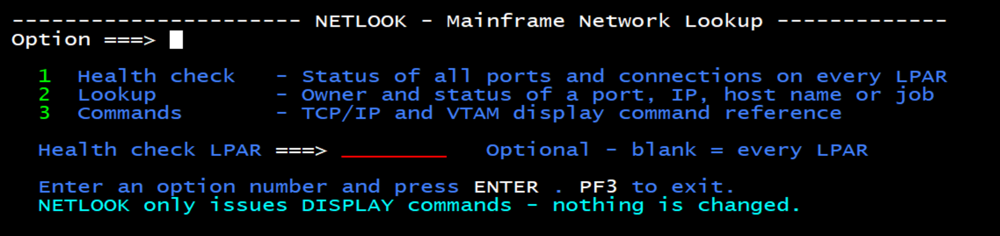
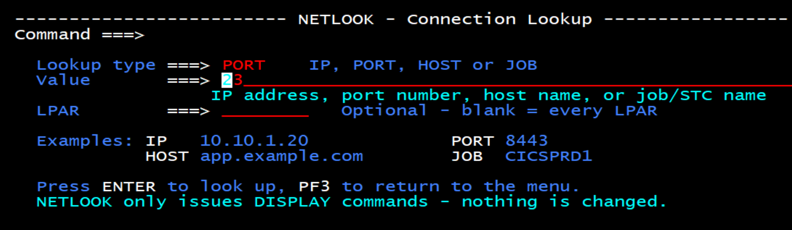

# NETLOOK – Mainframe Network Lookup Toolkit

**Author:** Rama Sachdeva · **Version:** 1.0.0 · **License:** Apache-2.0

NETLOOK is a lightweight, read-only REXX/ISPF toolkit for z/OS that gives an **overview of the mainframe network setup** and **helps diagnose network problems**. In one screen it shows which job owns each port, which LPAR owns each IP, what is listening, and what is connected to what, across every LPAR in the sysplex, so a failing website, FTP transfer or connection can be narrowed down quickly. It takes about five minutes to install, needs no network expertise to use, and only issues DISPLAY commands.

## Background

I am a z/OS systems programmer, not a network specialist, and our shop has no dedicated network resource. We regularly get network issues: users report that websites are not working, FTP transfers fail, or connections drop. Finding the cause meant running many display commands and knowing how to read them.

So I developed NETLOOK, a small REXX/ISPF toolkit. It runs network display commands in the background and gives a brief view of the network setup and its current status: what is listening on which port, which job/STC and LPAR own it, which IP belongs to which system, and what is connected to what. It helps shortlist the problem quickly.

NETLOOK is read-only. It uses only DISPLAY commands across every LPAR in the sysplex, and nothing on the system is changed.

NETLOOK is used online, from ISPF. Results open in an ISPF VIEW report.

## Requirements

| Item | Requirement |
| ---- | ----------- |
| z/OS | Tested on z/OS **X.Y** (EDIT: your tested level). Should work on any level with SDSF REXX support |
| SDSF | SDSF with REXX interface (`ISFCALLS`, `ISFEXEC`, slash commands and ULOG) |
| TCP/IP | z/OS Communications Server, one TCP/IP stack per LPAR |
| Sysplex | Single LPAR or multi-LPAR sysplex (uses `RO` to route commands) |
| ISPF | Standard ISPF; no additional products needed |

## Installation – 5 steps

The toolkit is one REXX exec and two ISPF panels. Upload every member as **text**, not binary.

1. **Allocate two PDS libraries** (RECFM FB, LRECL 80), for example `YOUR.NETLOOK.EXEC` and `YOUR.NETLOOK.PANELS`.
2. **Copy the exec:** upload `NETLOOK.rexx` into the exec library as member `NETLOOK`.
3. **Copy the panels:** upload `NETLOOKP.panel` (main menu) and `NETLKUP.panel` (lookup panel) into the panel library as members `NETLOOKP` and `NETLKUP`.
4. **Edit NETLOOK.** In the Site configuration block near the top, change two things:
   - Set `cfg.panlib = 'YOUR.NETLOOK.PANELS'` to your panel library. NETLOOK LIBDEFs it itself (and releases it on exit), so the panels do not need to be in your logon ISPPLIB.
   - Set `stackname.` to your TCP/IP started task name if it is not TCPIP. For each **other LPAR** in the sysplex, add `stackname.LPARNAME = 'tcpip_stc'` with that LPAR's TCP/IP started task name (needed whenever it differs from the default), e.g. `stackname.SYSB = 'TCPIPB'`.
5. **Run it from ISPF:**
   - `TSO EX 'YOUR.NETLOOK.EXEC(NETLOOK)'` runs it directly from the library, or
   - `TSO %NETLOOK` if the exec library is in your SYSEXEC or SYSPROC concatenation.

The main menu opens:

## Default values

Everything below works as shipped. Change a value only if you need to; all are in the **Site configuration** block at the top of NETLOOK.

| Setting | Default | What it does |
| ------- | ------- | ------------ |
| `cfg.panlib` | `YOUR.NETLOOK.PANELS` | Panel library NETLOOK LIBDEFs at start. **Must be changed** to your library |
| `stackname.` | `TCPIP` | TCP/IP started task name used in the `D TCPIP,<n>,NETSTAT` commands. Override per LPAR with `stackname.lparname` |
| `cfg.syslist` | blank | Blank = NETLOOK finds every LPAR in the sysplex automatically (SDSF SYS panel) |
| `cfg.delay` | `5` seconds | How long NETLOOK waits for each command's replies. Increase it if NOTES says a reply "looks incomplete"; decrease it for faster runs. One automatic retry with double the wait |
| `cfg.rdns` | `1` (on) | Shows the host name next to each remote IP in the connection map. Set `0` if DNS is slow |
| `cfg.maxopt` | `,MAX=*` | Returns all NETSTAT records, not just the first 100 |
| `cfg.width` | `79` | Report line width |
| Report dataset | `userid.NETLOOK.REPORT` | Created automatically, opened in VIEW |
| Command reference dataset | `userid.NETLOOK.CMDS` | Created automatically for option 3, opened in BROWSE |

**Authorities needed** – all display-only. Profile names vary by site and SDSF security setup, so have your security admin confirm them.

| What | Typical profile (class) |
| ---- | ----------------------- |
| SDSF REXX slash commands / ULOG | `ISFCMD.ODSP.ULOG.jesx` (SDSF) |
| Extended console for commands | `MVS.MCSOPER.userid` (OPERCMDS) |
| D TCPIP display | `MVS.DISPLAY.TCPIP` (OPERCMDS) |
| Route command to other LPARs | `MVS.ROUTE.CMD.sysname` (OPERCMDS) |
| SDSF DA panel (is the job running?) | `ISFCMD.DSP.ACTIVE.jesx` (SDSF) |
| SDSF SYS panel (find LPARs) | `ISFCMD.ODSP.SYSTEM.jesx` (SDSF) |

## Option 1 – Health check

Checks every reserved or listening TCP port on every LPAR and prints **ALL GOOD** when nothing needs attention. Leave the LPAR field blank for the whole sysplex, or name one LPAR.

The report has three parts:

- **Findings**: summary counts only (ports needing attention, ports listening normally, standby, blocked, stuck connections).
- **Port health table**: one row per LPAR and port, with job, status, established connections and a detail. Problems are listed first.
- **Connection map**: for each STC, the port it listens on, which remote IPs (and host names) are connected in, and which servers it connects out to.

| Status | Meaning |
| ------ | ------- |
| OK | Listening, no stuck connections |
| WARN | Listening, but connections stuck in SYNRCVD or CLOSWAIT |
| DOWN | Reserved job not running, and the port is not up on any LPAR |
| NOT LSTN | Reserved job running but not listening |
| STANDBY | Job not running here, but the port is up on another LPAR |
| BLOCKED | `PORT n TCP RESERVED` – closed on purpose |

**Commands issued in the background**, per LPAR (`RO sysname,` is added for remote LPARs):

1. SDSF SYS panel (`ISFEXEC SYS`) to find the LPARs, unless `cfg.syslist` is set.
2. `D TCPIP,<stack>,NETSTAT,ALLCONN,MAX=*`: listeners and connections.
3. `D TCPIP,<stack>,NETSTAT,PORTLIST,MAX=*`: PORT reservations from PROFILE.TCPIP.
4. SDSF DA panel (`ISFEXEC DA`), one call for the whole sysplex: which jobs are running.
5. Reverse DNS (`GETHOSTBYADDR`) for remote IPs in the connection map, cached, only when `cfg.rdns = 1`.

## Option 2 – Lookup

Use it when a user reports a problem. Pick a lookup type, enter a value, and optionally limit it to one LPAR.

| Type | Example | Answers |
| ---- | ------- | ------- |
| PORT | `8443` | Who owns the port (PORT statement), who is listening and on which IPs. If nobody is: is the owner running, or is the port blocked? |
| IP | `10.1.2.3` | Is this a mainframe address (HOME or VIPA) and which LPAR owns it? If not, is it a client, and what is it connected to? |
| HOST | `app.example.com` | Resolves the name with the z/OS resolver, then runs the IP lookup |
| JOB | `CICSPRD1` | Is it running, what does it listen on, are any reserved ports not listening, are connections healthy? |

The report shows **Findings** (owner, listening status, connection health) and **Details** (matching connections, reserved ports, IP ownership).

**Commands issued in the background**, per LPAR (`RO sysname,` for remote LPARs):

| Command | Used for |
| ------- | -------- |
| `D TCPIP,<stack>,NETSTAT,ALLCONN,MAX=*` | All lookups |
| `D TCPIP,<stack>,NETSTAT,PORTLIST,MAX=*` | PORT and JOB |
| `D TCPIP,<stack>,NETSTAT,HOME,MAX=*` | IP and HOST |
| `D TCPIP,<stack>,NETSTAT,VIPADYN,MAX=*` | IP and HOST |
| SDSF DA panel (`ISFEXEC DA`) | Is the owning job running? |
| Resolver `GETHOSTBYNAME` | HOST only |

NETLOOK filters ALLCONN itself instead of adding `PORT=` or `CLIENT=` to the command, because some z/OS levels do not return a complete reply with those filters.

## Option 3 – Command reference

Option 3 opens a TCP/IP and VTAM **display-only** command reference in ISPF BROWSE (`F` works for searching). It covers stack and interfaces, ports and connections, VIPA and routing, TN3270, AT-TLS and security messages, PING/TRACERTE/DNS, and VTAM. It ends with a list of commands *not* to use for checking (`V TCPIP,,DROP`, `OBEYFILE`, `V NET,INACT`, and similar).

The text is stored at the end of the NETLOOK exec between the `NETCMDS-START` and `NETCMDS-END` lines, so you can add your own site commands there. It is written to `userid.NETLOOK.CMDS` each time it is shown.

## Safety, limits and troubleshooting

**Safety.** NETLOOK issues only DISPLAY commands and SDSF reads. It writes only to your own datasets (`userid.NETLOOK.REPORT`, `userid.NETLOOK.CMDS`) and your ISPF profile. Job, LPAR and stack names are checked against valid z/OS name characters before they go into any command.

**Limits (v1).**

- IPv4 and TCP only. IPv6 sockets appear in the details but are not analyzed.
- One TCP/IP stack per LPAR (CINET multi-stack is not handled).
- Shows the current state, not history.

**Troubleshooting.**

| Symptom | Fix |
| ------- | --- |
| NOTES says "looks incomplete" for an LPAR | Raise `cfg.delay` |
| NOTES says "No reply from" an LPAR | LPAR down, RO not authorized, or the stack name differs: set `stackname.<lpar>` |
| Messages `ISF041I` / `ISF031I CONSOLE … MODIFIED` | Your SDSF console name was in use (SDSF open in another screen). Harmless, but close other SDSF sessions if replies go missing |
| Results look wrong | From **ISPF option 6** (TSO command shell), run `%NETLOOK PORT 23 DEBUG`. It shows the raw command replies NETLOOK received, so you can compare them with the report |

## Reporting issues and feedback

Found a bug, have a z/OS level where NETLOOK behaves differently, or using it at your site? Please [open an issue](https://github.com/RSachdeva29/zos-netlook/issues). Include your z/OS level, the option you ran, and the DEBUG output **with IP addresses and system names masked**.

Feedback on how NETLOOK helped at your shop is very welcome too.

## Changelog

- **1.0.0** (October 2026) – Initial release: health check, lookup (PORT, IP, HOST, JOB), command reference.

## License

Licensed under the [Apache License 2.0](LICENSE).

